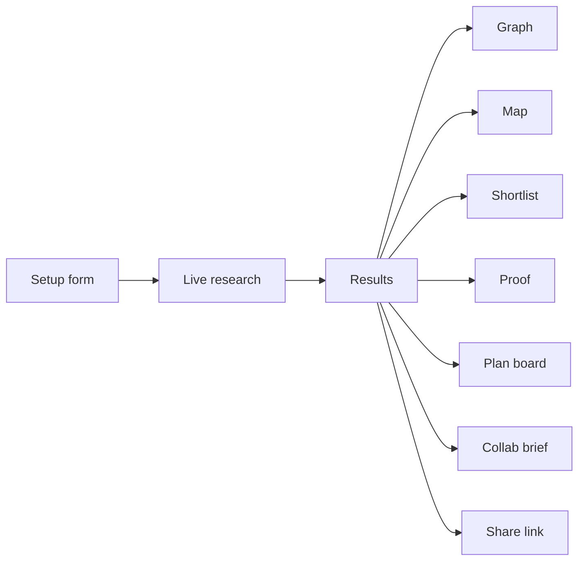
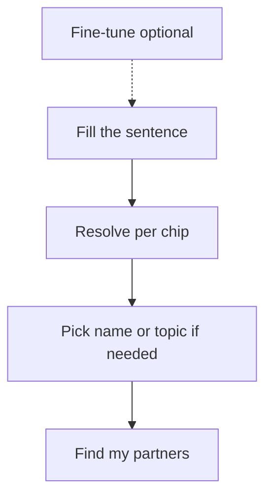
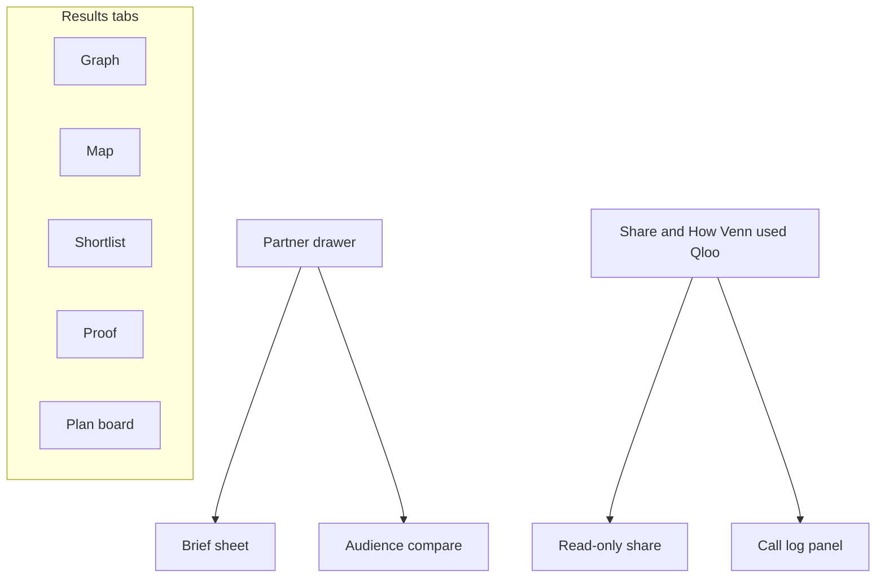
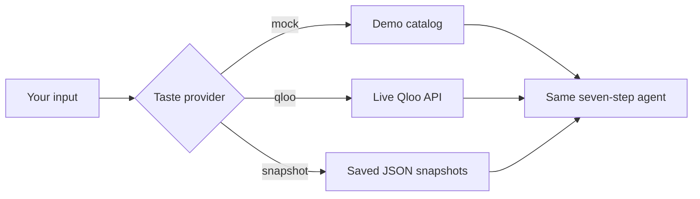

# Venn — everything that is built

Plain-language list of what the product can do today. If it is not listed here, it is not shipped (or was skipped on purpose).

---

## Big picture



Venn helps a small business find partners whose **audiences share taste** (brands, artists, places), shows the overlap, and drafts a pitch. Taste data comes from **Qloo** (or demo data, or saved Qloo snapshots).

---

## Setup (home screen)

- One-sentence form: business type, optional name, city, anchors (things customers love)
- Example chips that fill the form for you
- Form remembers your last answers in the browser
- Optional **Fine-tune**:
  - Goals (e.g. more footfall, events, content) — pick up to two
  - How local (near me / local + brands / anywhere)
  - How ambitious (light / balanced / ambitious)
  - Names or categories to avoid
- Each chip resolves as you type into **Names** and **Topics**; ambiguous / too-broad chips open a popover. Optional AI **Suggested** picks are verified on Qloo first (see `docs/ANCHORS.md`)
- Submit sends confirmed `tasteAnchors` (entities + tags) for ranking
- Provider badge: Demo data, Powered by Qloo, or Saved Qloo results
- **About** (footer / `#about`): what Venn is, Qloo surfaces used, MIT licence, safe-use notes



---

## Research (while it searches)

- Seven clear steps: understand taste → plan → discover → score → enrich → adapt → assemble
- Live progress over a stream (SSE); you can cancel
- Tool log shows what the agent is doing
- Agent notes with origin pills (Rule / Qloo / AI)
- If the server is busy, you can wait in a queue
- Refresh mid-run can reconnect to the same search
- Snapshot mode can **replay a saved Qloo run** (labelled as saved, not live)

---

## Results — five views

### Graph

- Literal Venn-style graph of you vs partners
- Surprise slider and kind filters
- Top picks tray (best overall, local, wildcard, and **best for your goal** when goals are set)
- Expand connections (up to 28 partners)
- Partners you **check yourself** show as dashed “Your pick” nodes (max 5)

### Map

- Neighbourhood heatmap from Qloo (when local data exists)
- Toggle: busy/on-taste vs **where your crowd over-indexes** (taste lift)
- Real pins for place partners (address / website in the drawer when Qloo has them)
- Closed places are dropped

### Shortlist

- Sortable list with pins
- Feasibility chips (easy / needs a warm intro / long shot)
- Goal-fit sorting when goals are set
- CSV export of the shortlist

### Proof

- Compares **obvious picks** vs **Venn’s picks**
- Ranks both sides together in the **same Qloo call** per kind (honest comparison)
- Paired lists, summary numbers, caveats
- Older runs without the new ranking data show a calm “re-run” message

### Plan (outreach board)

- Columns: To contact → Contacted → In talks → Done → Passed
- Drag cards or use **Move to…** (keyboard-friendly)
- Notes stay only in your browser (not on the server)
- Add top 5 / clear board



---

## Partner drawer

- Match score ring and reasons
- Evidence split into **data** vs **interpretation**
- Explainability lines when Qloo says which anchors drove the match
- Feasibility and goal-fit chips
- Venue details (address, neighbourhood, website) for places
- **Compare audiences** (shared / only you / only them tags)
- Open brief

---

## Collab briefs

- Template briefs always work (no AI key needed)
- With OpenAI on (`LLM_PROVIDER=openai`, model **gpt-6-luna**):
  - AI-written briefs from real evidence only
  - Tone (warm / direct / playful) and length (short / standard)
  - Citation numbers → Sources list
  - Editable outreach email (copy without saving edits to the server)
  - Chip shows **AI · gpt-6-luna** or **Template**
- If AI fails checks, falls back to the template honestly
- Copy as text / print / copy outreach
- Per-run AI brief budget so quota is not blown

---

## How Venn decides (steering)

- Goals never change the raw match score; they add a separate **goal fit**
- Reach and avoid filters change who appears
- Decision log: “How Venn decided” on results + live notes during research
- Feasibility: easy / warm intro / long shot (optional AI critique can nudge one step only)

---

## Data sources (taste)

| Mode | Meaning |
| --- | --- |
| Mock | Built-in demo data for tests and offline use |
| Qloo (live) | Real hackathon API (`X-Api-Key` on the server only) |
| Snapshot | Saved real Qloo results for the three examples (London / Manchester / New York) |

- Built-in examples can use saved snapshots so judges always see a full run
- `live: true` forces a fresh live search



---

## Honesty and safety (built into the product)

- Scores are **relative to this search** and **group-level**, not about individual customers
- Numbers and sentences show where they came from (data / interpretation / rule / AI)
- Proof/Check only compare things ranked in **one** Qloo call
- No customer lists, emails, or phone numbers sent to Qloo or the LLM
- API keys never go to the browser
- CSP and security headers on; fonts self-hosted

---

## Ops / reliability (server)

- Runs saved in SQLite (plus a fast in-memory layer) so a restart does not wipe finished searches
- Queue limits how many live searches run at once
- Per-IP daily cap for live runs
- Qloo client: retries on 429, circuit breaker, rate pacing, monthly quota floor
- Health endpoint: provider, store, queue, circuit, LLM on/off, quota remaining
- Usage ledger: how many Qloo / LLM calls today
- Per-run **Qloo call log** (“How Venn used Qloo”)
- Share link: read-only copy of a result (`#share/<token>`), time-limited
- Deploy notes in `docs/DEPLOY.md`
- About / MIT licence / public repo metadata

---

## Not built (on purpose / out of time)

- Age-band demographics UI (Qloo returned empty in our probe)
- Live trend sparklines (trending endpoint failed on hackathon host)
- Full partnership PDF export pack
- Agency brand-kit white-label
- Three-way Venn (7.3)
- Playwright end-to-end suite

---

## How to run it

```text
npm install
npm run dev
```

- Website: http://localhost:5173  
- API: http://127.0.0.1:8787  

Put secrets only in local `.env` (never commit them): `QLOO_API_KEY`, and for AI briefs `LLM_PROVIDER=openai` + `OPENAI_API_KEY` with `LLM_MODEL=gpt-6-luna`.
