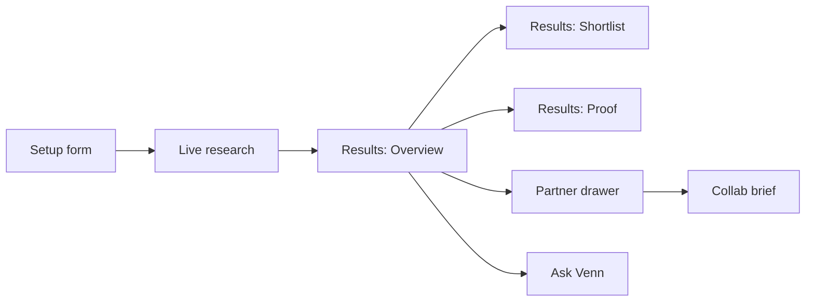

# Venn — everything that is built

Plain-language list of what the product can do today, verified against the current code. If it
isn't listed here, it isn't shipped, or it's listed under "Built but not currently reachable" at
the end.

---

## Big picture



Venn finds the businesses and brands whose audiences already overlap with yours, shows that
overlap on a dashboard and a map, and drafts the pitch. Taste data comes from Qloo — live, a
saved Qloo snapshot, or an offline demo catalog, depending on `TASTE_PROVIDER`.

---

## 1. Setup

- One-sentence form: business type, optional business name, city, and a few things your
  customers love ("anchors").
- Two ways to add anchors:
  - **Swipe your crowd** — a deck of Qloo-checked taste cards (brands, artists, places, topics)
    you yes/no through; a refill deck is drawn live from Qloo based on what you said yes to
    (`POST /api/anchors/cards`, `/cards/refill` — see `docs/ANCHORS.md`).
  - **Type them** — each typed anchor is resolved against Qloo as you go; an ambiguous or
    unmatched one ("Aesop" the brand vs. the storyteller, or a typo) gets an AI-suggested
    rewrite, verified against Qloo before it's offered, never shown as a fact until confirmed.
- **Fine-tune the search** (optional, collapsed by default):
  - Up to two collaboration goals (more footfall, a new audience, content, events, bundles,
    shared costs, stockists) — these never change the match score, only tie-break ordering and
    add a "goal fit" note.
  - Search radius (near me / local and brands / anywhere).
  - Appetite for how bold a collaboration to suggest.
  - An "avoid" list of partner types or names to keep out of results.
- Example chips that fill the whole form in one click, for a fast first run.
- The form remembers your last answers in the browser between visits.

---

## 2. Research (while it searches)

- Seven steps, streamed live over SSE, each with its own state (waiting / running / done /
  retry): understand taste → choose where to look → search for candidates → score fit → check
  trends and local popularity → adapt/double-check coverage → assemble the map.
- A live map of the search city fills in as anchors resolve and candidate kinds are chosen.
- "From Qloo" feed: the actual Qloo calls the agent is making, shown as they happen (request
  shape in, candidate count back, with timing).
- Decision log entries ("Did not widen the search — 19 strong matches already") explain *why*
  the agent made a call, not just what it did; these persist on the finished result too.
- You can cancel mid-search, and a page refresh reconnects to the same in-flight search instead
  of losing it.
- An unsupported city doesn't invent local data — it searches global brands/artists only and
  says so in the result's notes.

---

## 3. Results — Overview

The default results view: one dashboard, every chart keyed to the same selected partner, so
clicking a dot, a bar, or a card anywhere follows that partner through all of them.

- **Orbit chart** — partners placed by taste overlap, grouped by kind, distance from centre =
  overlap score.
- **Picks panel** — "Start with these three": a mix of safe, easy-to-reach fits and one
  pleasant surprise, plus an "also worth a look" list.
- **Scatter chart** — overlap score vs. how easy the partner is to approach (local, size,
  reachability), so you can see the quadrant worth messaging first.
- **Map panel** — pins for local place partners, with a "taste lift" toggle switching from raw
  popularity to where your crowd specifically over-indexes; brands/artists with no fixed
  location are listed separately underneath instead of being dropped.
- **Flow chart** — which shared-taste themes are driving the most overlap, by partner.
- **Selected-card panel** — "Why they match": the selected partner's top shared tastes as
  scored bars, a one-line opener for a first message, and buttons to draft outreach or add to
  the shortlist.
- **"Pull a taste" tags** — drag or press a shared theme to light it up and re-weight every
  chart around it at once ("taste magnets").
- Filters that apply to every chart: kind, a safe-fits-to-wildcards slider, and a "realistic for
  me" toggle that hides long-shot partners.
- **Ask Venn** chat and **How Venn used Qloo** call log, both reachable from the header (see
  below).

---

## 4. Results — Shortlist

- The same partners as a sortable table (score, surprise, goal fit, name), with a kind filter.
- Pin the ones worth contacting; pinned partners carry a count badge on the Shortlist tab.
- Feasibility chips: easy / needs a warm intro / long shot.
- CSV export of the shortlist (pinned rows first).
- Clicking a row opens the partner drawer.

---

## 5. Partner drawer (from the Shortlist)

- Match score, the reasons behind it, and evidence split into **data** (a real number) vs.
  **interpretation** (what Venn makes of it).
- Explainability line when Qloo says which of your anchors actually drove the match.
- Feasibility and goal-fit chips.
- Venue details for place partners: address, neighbourhood, website.
- Toggleable **audience compare**: shared tastes, tastes only your crowd rates highly, tastes
  only theirs does.
- Opens the collaboration brief.

---

## 6. Proof (and Check a partner)

Open from the results header, next to Overview and Shortlist.

- **Proof**: ranks Venn's own picks together with an "obvious" baseline — the popularity
  leader, or an LLM-suggested well-known name when one is configured — in the *same* Qloo
  `rankTogether` call per kind, so the two scores are directly comparable, not guessed
  separately. A head-to-head bar shows the run's average score for each side, a plain-English
  verdict ("+N average points ahead"), and a per-kind breakdown with a Venn-ahead / baseline-
  ahead / tied badge.
- Bounded by `PROOF_MAX_CALLS`; a kind with no recorded discover call (a legacy run, or a
  provider that can't replay one) shows a note instead of a guessed score.
- **Check a partner**: type any brand, artist or place and Venn scores it on this search's
  frozen scale, adding it to the Overview as a dashed "Your pick" node — up to 5 per search.

---

## 7. Collaboration brief

- One-page pitch per partner: concept, why it fits (with footnote-style citations into a
  sources list), a first step, a two-week plan shown as a timeline, what to measure, risks, and
  an editable outreach email.
- A "fit lens" diagram in the header — the brand's two-circle mark with the overlap score in
  the shared sliver — plus the format and partner kind as pills.
- Tone (warm / direct / playful) and length (short / standard), three concept variants to cycle
  through, and a regenerate button.
- Written by an LLM from the run's own evidence when one is configured; falls back to a
  deterministic template otherwise. Either way, nothing is invented — an LLM citing an evidence
  id that doesn't exist in the run's own fact pack fails validation and gets rewritten or
  replaced by the template, never shown as-is. The brief never says who or what wrote it.
- Copy as text, copy the outreach email, or print / save as PDF.

---

## 8. Ask Venn (chat)

- A chat panel, open from the results header, for free-form questions about the finished search
  — who to approach, why something ranked where it did, what's missing.
- Grounded the same way the brief is: the model gets a fact pack built only from this run's real
  partners, scores, tags and decisions, and is told to say "I don't know" rather than guess when
  the question falls outside it (verified: asked to compare partner pricing, it said pricing
  isn't in the data instead of inventing a number).
- Replies that name specific partners show them as clickable chips; clicking one selects that
  partner, which highlights it across every Overview chart the same way clicking a chart element
  does.
- Remembers the conversation for natural follow-ups, capped per run
  (`LLM_CHAT_BUDGET_PER_RUN`, default 20 replies) so an open-ended conversation can't blow the
  Qloo/LLM budget.
- No LLM configured, or budget spent: a calm note in the panel explains that, rather than a
  broken input or a fake answer.

---

## 9. Share

- `POST /api/runs/:id/share` snapshots the finished result under an opaque token
  (`#share/<token>`, 7-day TTL by default) — a read-only copy, not a link back to the live run,
  so it still works after the run itself expires.
- Share link copies straight to the clipboard.

---

## 10. How Venn used Qloo

- A panel, open from the results header, listing every live Qloo HTTP call this search made —
  grouped by research step, with the path, params (redacted/truncated, no secrets), and timing.
- Demo and snapshot runs say plainly that no live Qloo calls were made, instead of showing an
  empty list with no explanation.

---

## 11. Taste data (providers)

| Mode | Meaning |
| --- | --- |
| Mock | Built-in demo catalog — works fully offline, no keys needed |
| Qloo (live) | Real hackathon API, key held server-side only |
| Snapshot | Saved real Qloo results for the three built-in examples, so judging doesn't burn quota |

`TASTE_PROVIDER` picks the default; `EXAMPLES_MODE` separately controls whether the three
built-in examples always replay their saved snapshot or always go live.

---

## 12. Honesty and safety, built into the product

- Match scores are relative to this one search and group-level — never a claim about an
  individual, and no customer data is used.
- Every number and sentence is traceable to where it came from: a real Qloo figure, a rule, or
  an LLM citing a specific piece of evidence from the run.
- No personal data, customer lists, emails, or phone numbers are ever sent to Qloo or an LLM.
- API keys never reach the browser.
- Security headers on; fonts self-hosted.

---

## 13. Ops / reliability (server)

- Runs persist in SQLite (`DATA_DIR`), so a restart doesn't lose a finished search
  (`RUN_TTL_HOURS`, 24h default).
- A queue limits how many live searches run at once, plus a per-IP daily cap on live runs.
- Qloo client: retries on 429, a circuit breaker, client-side rate pacing, and a monthly-quota
  floor that refuses new live runs once the key is running low (so it survives through judging).
- `GET /api/health`: provider, store, queue depth, circuit state, whether an LLM is configured,
  quota remaining.
- Usage ledger: how many Qloo calls and LLM calls have been made today (`GET /api/usage` for the
  last 14 days).
- Per-run Qloo call log and chat/brief budgets, each capped independently.

---

## Built but not currently reachable in the UI

- The old single literal Venn-diagram graph view (`src/components/results/graph/`) — superseded
  by the Overview's orbit chart and the Proof tab, left in the tree unused.

---

## Not built (on purpose or out of time)

- Age-band demographics UI (Qloo returned empty in probing)
- Live trend sparklines (the trending endpoint failed on the hackathon host)
- Full partnership PDF export pack
- Agency brand-kit white-label
- Three-way Venn (business + two partners at once)
- A dedicated Playwright end-to-end suite (covered today by ad hoc Playwright scripts + Vitest
  instead)

---

## How to run it

```bash
npm install
npm run dev
```

- Website: http://localhost:5173
- API: http://127.0.0.1:8787

`TASTE_PROVIDER` defaults to `mock`, so this runs with no API keys. For live data, set
`TASTE_PROVIDER=qloo` and `QLOO_API_KEY`; for AI briefs and chat, set `LLM_PROVIDER` and a
matching key. See the root `README.md` and `.env.example` for the full list.
