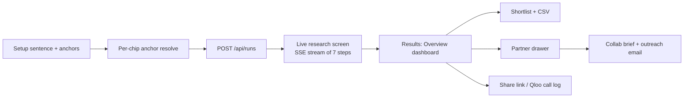

# Venn — complete product overview

> A full description of what Venn is, everything it does, every screen and feature, how the agent works under the hood, how scores are made, how the app looks, and how it is run. Reflects the code as of October 2026 (current working tree, including the dashboard-style Overview results page).

---

## Contents

1. [What Venn is](#1-what-venn-is)
2. [The end-to-end journey](#2-the-end-to-end-journey)
3. [Screen 1 — Setup (the cover page)](#3-screen-1--setup-the-cover-page)
4. [Screen 2 — Research (the live agent run)](#4-screen-2--research-the-live-agent-run)
5. [Screen 3 — Results](#5-screen-3--results)
   - [Results header](#51-results-header)
   - [Overview dashboard](#52-overview-dashboard)
   - [Shortlist](#53-shortlist)
   - [Partner drawer](#54-partner-drawer)
   - [Collab brief](#55-collab-brief)
   - [How Venn used Qloo (call log)](#56-how-venn-used-qloo-call-log)
   - [Share links](#57-share-links)
6. [The agent pipeline (seven steps)](#6-the-agent-pipeline-seven-steps)
7. [Taste anchors — how inputs become Qloo signals](#7-taste-anchors--how-inputs-become-qloo-signals)
8. [Scoring — what every number means](#8-scoring--what-every-number-means)
9. [Steering: goals, reach, appetite, avoid, feasibility](#9-steering-goals-reach-appetite-avoid-feasibility)
10. [Taste providers: Qloo, snapshot, mock](#10-taste-providers-qloo-snapshot-mock)
11. [AI / LLM usage](#11-ai--llm-usage)
12. [Visual style and design system](#12-visual-style-and-design-system)
13. [Motion, accessibility and responsiveness](#13-motion-accessibility-and-responsiveness)
14. [HTTP API](#14-http-api)
15. [Server, storage and reliability](#15-server-storage-and-reliability)
16. [Configuration (environment variables)](#16-configuration-environment-variables)
17. [Tech stack](#17-tech-stack)
18. [Scripts, tests and deployment](#18-scripts-tests-and-deployment)
19. [Honesty and safety principles](#19-honesty-and-safety-principles)
20. [Built but not currently surfaced / not built](#20-built-but-not-currently-surfaced--not-built)

---

## 1. What Venn is

**Venn is a taste-collaboration agent.** A small business (café, gym, record shop, bar, hotel…) describes itself in one sentence — what it is, where it is, and a few brands, artists, places or interests its customers love. Venn then:

1. Turns those "anchors" into real taste signals in **Qloo's** taste graph.
2. Runs a seven-step agent that searches for brands, artists and local places whose **audiences overlap** with that crowd.
3. Scores each candidate by **mutual affinity** (how much your crowd likes them *and* how much their crowd likes your anchors).
4. Shows the result as an interactive dashboard: a radial "orbit" of partners, top picks, an overlap-vs-ease scatter, a neighbourhood map, a Sankey of shared taste themes, and crowd-comparison Venn bars.
5. Writes a one-page **collab brief** with a ready-to-send outreach email for any partner.

Positioning line on the cover: *"Find partners whose audiences already overlap with yours."* It is an entry for the **Qloo Agentic Hackathon 2026**, MIT licensed.

Core principle: Venn starts from **taste**, not industry or follower count, and only uses **public, group-level** taste signals — never customer lists or personal data.

---

## 2. The end-to-end journey

1. **Setup** — fill the sentence, confirm each anchor's match, optionally fine-tune goals.
2. **Research** — watch the agent work live on a map with step progress and a live Qloo feed; cancel any time.
3. **Results** — explore the Overview dashboard; every chart follows the selected partner.
4. **Act** — pin partners to a shortlist, export CSV, compare crowds, generate a brief, copy the email, print to PDF, share a read-only link.

---

## 3. Screen 1 — Setup (the cover page)

### Layout
- **Header:** Venn logo (three-circle Venn mark) on the left; **About** and **Source code** (GitHub) links on the right.
- **Two-column cover** on laptops (form column ≈40rem on the left, example card on the right, pinned to the viewport height); stacks vertically and scrolls on mobile.
- **Ambient circles** — soft decorative coral/blue/plum circles floating behind the page.
- **Eyebrow:** "TASTE COLLABORATION AGENT · POWERED BY QLOO".
- **Headline:** "Find partners whose audiences already overlap with yours."
- **Lede:** explains you name your business plus a few things your customers love, and Venn ranks nearby collab fits and drafts the pitch.
- **Footer:** "Venn, a taste collaboration agent, powered by Qloo data." + a "Qloo Agentic Hackathon 2026 Entry" badge + About / Source code links.

### The sentence form
Reads like a sentence rather than a wizard:

> I run a **[business type]** called **[optional name]** in **[city]**. **My customers love** [anchor chips].

| Field | Behaviour |
| --- | --- |
| **Business type** | 13 options: café, restaurant, bar, music venue, gym or studio, shop, fashion brand, bakery, bookshop, salon or spa, hotel, coworking space, other. "Other" reveals a required custom-description field. |
| **Business name** | Optional, max 60 chars. Used in headlines, charts ("you") and briefs. |
| **City** | Free text; suggests London, Manchester, New York (demo cities) but any city works. |
| **Anchors** | 1–6 chips. Enter or comma adds; paste comma lists; Backspace on empty removes last; duplicates rejected; 2–60 chars each; rotating placeholders (Aesop, Radiohead, pilates…). Helper: "Add up to six. Press Enter after each one — Venn matches names and topics as you go." |

**Validation messages** (submit disabled until valid): "Describe your business in a few words.", "Enter a city.", "Add at least one thing your customers love.", "Keep the name under 60 characters.", "Pick at least one matched name or topic to rank partners."

### Per-chip anchor resolution
Every chip is resolved live against Qloo (`POST /api/anchors/resolve`) into a status:

- **entity** — a clear named match (e.g. *Aesop* the brand)
- **topic** — a clear interest/tag match (e.g. *pilates*)
- **ambiguous** — several close Names/Topics → a popover lets you pick
- **too_broad** — a generic word that wouldn't change ranking
- **unresolved** — nothing plausible above the 0.6 similarity floor

Candidates are split into **Names** (entities) and **Topics** (tags). Popularity is used to disambiguate (Aesop the brand vs an obscure place called Aesop). When an LLM is configured, **AI suggestions** are offered, but only after being **verified against Qloo**, and labelled **Suggested**. Unconfirmed chips are kept as notes only (used in headlines, not sent to ranking). Full detail in `docs/ANCHORS.md`.

### Fine-tune (optional, collapsible)
"Fine-tune the search" opens four fields:

- **Collaboration goals** (pick up to two): More footfall · A new audience · Content to share · Co-host events · Bundle offers · Share costs · Get stocked.
- **How far should Venn look?** Just nearby · Local + known brands · Anywhere.
- **Appetite for a collaboration:** Light — a small trial · Medium · Ambitious.
- **Avoid:** free-text partner types or names.

These never change the raw match score (see §9).

### Example chips
One click fills a full example and staggers the anchors in (120 ms each):
1. **Brew & Co** — café in London — Aesop, Radiohead, pilates
2. Gym or studio in Manchester — Patagonia, craft beer, bouldering
3. **Second Spin Records** — shop in New York — Bandcamp, Polaroid, natural wine

Built-in examples are served from **saved Qloo snapshots** by default so a full run always works (configurable via `EXAMPLES_MODE`).

### "Example: what you get" sample card
A carousel on the right previewing the output with three demo graphs:
- **Signal** — "Stronger matches draw a thicker cable from you." (orbit-style signal map)
- **Heat** — "How each taste lights up against each partner." (anchors × partners heat grid)
- **Scores** — "Match strength side by side — pick one to focus."

With previous/next controls and a "Selected match" detail.

### Other setup details
- **Primary CTA:** "Find my partners" (shows "Starting…"), with the note "No CRM upload. Only public taste signals — then a shortlist, map, and ready-to-send brief."
- **Provider badge:** "Demo data", "Powered by Qloo", or "Saved Qloo results" depending on provider. In demo mode a hint says demo only knows a few brands.
- **Persistence:** last form saved to `localStorage` (`venn:input`); older saved shapes are migrated.
- **About dialog** (also via `#about`): what Venn is, three steps (01 Tell Venn your tastes → 02 Find shared crowds → 03 Send the pitch), badges (Powered by Qloo, Public taste only, Group-level scores, Hackathon 2026), the list of **Qloo surfaces used** (endpoint paths), version, MIT licence and safe-use notes.

---

## 4. Screen 2 — Research (the live agent run)

Once you submit, the app switches to a live research stage driven by a Server-Sent Events stream.

### Elements
- **Headline:** "Looking for crowds like yours…" → "Found your overlap." (or "The search paused." on error).
- **"What you asked for" pills:** business type, city, and up to four anchors. The anchor pills animate ("fly") into the map during the resolve step.
- **Research map** — a full MapLibre vector map (OpenFreeMap tiles, OpenStreetMap data) centred on your city. As steps progress it plots discovered places as pins, shows busy-area heat, marks closed places, and displays status captions like "Finding busy areas", "Checking they are open", "No places found nearby". Unknown cities fall back to a sensible centre.
- **Research steps** — the seven steps as a vertical checklist with tick animations; each shows a live sub-line from the agent's notes (e.g. "Matching your anchors…", "Picking where to look…", "Looking nearby…", "Comparing with how busy each area is", "Checking they are still open…", "Placing partners on your map…") and a completed summary.
- **Percent gauge** — two circles sliding together as progress goes 0 → 100%.
- **Circles loader** — "Audience overlap" card with animated coral/blue/plum circles, a radar-like scan sweep, per-step captions ("Matching brands and topics to taste signals", "Pulling candidates whose crowds overlap yours", "Ranking by shared audience strength"…), "Searching kinds" chips listing the partner kinds being searched, and "Shortlist ready" when done.
- **From Qloo feed** — a light card showing the last two real request/response pairs from the run's Qloo call log ("Waiting for the first call…" initially).
- **Counts** of open vs closed venues and brand partners found.
- **See partners** CTA once done (results also auto-open after a short settle).
- **Cancel** button (ghost) and the hackathon badge.

### Behaviour
- **Gated steps:** visuals advance at a readable pace even when the server is fast (`useGatedSteps`).
- **Settle:** after the result, waits ~600 ms (0 with reduced motion) before results.
- **Restore on refresh:** `sessionStorage` (`venn:runId`). Running → reconnect with `Last-Event-ID` replay; done → straight to results; expired → back to setup.
- **Queueing:** if the server is at its concurrency limit, the run waits in a queue.
- **Errors:** "Something got in the way" with **Try again** and **Edit my answers**; Qloo-specific messages (key, rate limit) surfaced when useful.
- **Screenshot fixtures:** a `#research-shot/...` hash renders any step deterministically for docs screenshots.

---

## 5. Screen 3 — Results

Results has two tabs: **Overview** (the dashboard) and **Shortlist**. All results pages use the fluid UI scale so charts and text scale with the screen.

### 5.1 Results header
Sticky bar shared by both tabs:
- Venn mark + wordmark (links home).
- **Query summary** — business type · city · first two anchors, separated by dots.
- **Tabs:** Overview / Shortlist (Shortlist shows a count badge of pinned partners).
- **How Venn used Qloo** — opens the call log panel.
- **Share** — creates and copies a share link ("Copying…").
- **New search** — resets to Setup.

Escape closes the brief first, then the drawer/selection.

### 5.2 Overview dashboard
A single scrolling dashboard where **one partner is always selected** and every chart highlights it. Hovering any dot, bar or card highlights that partner across every chart simultaneously (global `hl-on` mode). Up to **12** partners are shown (`OVERVIEW_MAX`).

#### Hero
- **Title:** "*{Top partner}* is your strongest overlap. Venn found *N* partners across *K* kinds."
- **Lede:** "Ranked from Qloo taste data for *{anchors}* in *{city}*. Click any dot, bar or card and it follows that partner through every chart."
- **Stat strip** (4 figures): Partners ranked (+ number of kinds) · Best overlap (score + name) · Easy to reach (of N) · Within 3 km (of N local, or "no local places").

#### Filters (apply to every chart)
- **Kind chips** — All + one chip per partner kind present, each with its colour dot and count.
- **Safe fits ↔ Wildcards slider** — re-ranks partners: at 0 by match score; toward 1 blends in surprise (`rank = (1−s)·match + s·(0.5·match + 50·surprise)`).
- **"Realistic for me" switch** — hides "long shot" partners.

#### Row A — Orbit + Picks
- **Orbit panel ("Your crowd and theirs")** — a radial chart with you at the centre; each partner is a dot placed by taste overlap ("The closer a dot is to the centre, the more of its crowd is also yours"), coloured by kind, sized by Qloo popularity when known. Uses real circle-intersection maths so distance reflects overlap fraction. Includes an accessible data table (Partner, Kind, Overlap, Busy (Qloo)).
- **Picks panel ("Start with these three")** — top three cards, captioned by slider position ("Safest fits first: strong overlap and an easy way in." / "Wildcards first: they still overlap with you, but less obviously."), plus an **"Also worth a look"** list.

#### Row Selected — Selected card
Detail for the current partner: name, kind, location/distance (or "No fixed location"), match score, reach tier, top shared themes with **your crowd's Qloo affinity bars** (never invented numbers — mock/snapshot runs show tags without percentages), a **first-message idea** ("Lead with *{theme}* — both crowds rate it highly. Propose one small joint next step."), and actions **Draft brief** and **Add to shortlist / Added to shortlist**.

#### Row B — Scatter + Map
- **Scatter panel** — x = taste overlap with you; y = **Ease of approach** (Safe mode) or **Surprise** (Wildcard mode). Highlights a top-right quadrant labelled **"Message first"** or **"Bold bets"**. Subtitle discloses which axis is Qloo data and which is Venn's estimate. Empty titles: "No partner is both close in taste and easy to reach yet" / "No bold bets clear the bar yet". Data table: Partner, Overlap, Ease/Surprise (Venn), Busy.
- **Map panel** — Leaflet map on OpenFreeMap tiles centred on the city; numbered/coloured pins for place partners, tooltips, and Qloo **heatmap** spots for the selected partner with a **lift toggle** (busy & on-taste vs where your crowd over-indexes). Data table: Partner, Distance, Area, Overlap. Brands show "No fixed location".

#### Row C — Sankey + Compare/Themes
- **Sankey panel** — flows from **Your anchors → Shared taste themes → Partners** for the top partners; "A thicker flow means more of the overlap comes from that theme." Data table: Theme, Share of match, Feeds.
- **Compare bars panel** (when compare data exists) — "Venn bars" for the selected partner: your crowd's top tastes scored for both crowds by Qloo (out of 100), each bar split into **only yours / both / only theirs**. Table: Taste, Your crowd, Both, Their crowd. Labels whether tags came from live `/v2/analysis/compare` or were computed from the run's own tags.
- **Themes panel** (fallback) — "What your crowds have in common": shared taste themes across your top partners ranked by share of the overlap.

#### Footer
"Taste data from Qloo. Ranking, ease and surprise added by Venn."

#### Chart conventions
Every chart is a `ChartCard` with title, subtitle, a shared floating tooltip (`OverviewTip`), keyboard-activatable marks (Enter/Space), and a toggleable **data table** for accessibility. Charts reveal with a staggered entrance (`useReveal`) unless motion is reduced.

### 5.3 Shortlist
Shares the dashboard styling.
- **Header:** "Build your shortlist" (or a count) with explanation: pin the partners worth contacting; the shortlist feeds briefs and CSV export.
- **Stats:** best match, number of kinds, etc.
- **Filter & sort bar:** kind chips; sort by **Match**, **Surprise**, **Goal fit**, **Name**; **Download CSV** (`venn-shortlist.csv`, pinned rows first, built in the browser).
- **"Your shortlist" section** — pinned partners ("Nothing pinned yet. Use the pin on any partner below, or 'Add to shortlist' on the Overview.").
- **All partners list** — rows with match ring, kind, local/brand label ("Brand · no fixed location"), reason line, feasibility chip, pin toggle. Clicking a row opens the drawer.

### 5.4 Partner drawer
Side drawer (bottom sheet on mobile) with scrim, focus trap and close button:
- Name, kind, location/distance.
- **Match ring** — labelled "Mutual Qloo affinity: your crowd and theirs" (live) or "Relative to this search" (mock/snapshot).
- Chips: **feasibility** (Easy ask / Warm intro / Long shot, with "· AI" if AI-adjusted), **goal fit**, "On your shortlist".
- Feasibility reason line.
- **Why this fits** — reason bullets.
- **Shared tastes** — measured shared tags (or "No taste both crowds rate highly was reported for this partner."), plus **drivers**: which of your anchors drove the match, from Qloo explainability.
- **Venue** — address, neighbourhood, website (places only; closed places are filtered out entirely).
- **Evidence panel** — split into **From the taste data** vs **Venn's interpretation**, plus run limits.
- **Also pairs well with** — related partner chips.
- Actions: **Create partner brief**, **Add to shortlist / Unpin**, **Compare crowds / Hide compare** (inline audience compare), **Expand connections** (adds related partners up to the 28 cap).

### 5.5 Collab brief
A sheet with a printable one-pager for the chosen partner:
- **Title, format and concept.**
- **Why it fits** — points with evidence, numbered citations linking to a **Sources** list (LLM briefs).
- **First step** and a **Two-week plan** table (when / action).
- **What to measure** and **Risks**.
- **Outreach email** — editable subject and body (edits stay in the browser), with **Copy outreach email**.
- **Limits** footer + "Made with Venn" + data label (Powered by Qloo / Demo data).
- Chip showing **AI · *{model}*** or **Template**.

Actions: **Copy as text**, **Print / Save as PDF** (print CSS isolates `#brief-print`), **Try another concept** (cycles variants). With an LLM: tone (warm / direct / playful) and length (short / standard). Template writer: 3 concept variants for each of the 9 partner kinds (27 total), always available. AI briefs are validated (only real evidence, no invented facts) and fall back honestly to the template on failure; a per-run AI brief budget (default 6) protects quota. Briefs are cached per partner+variant.

### 5.6 How Venn used Qloo (call log)
A panel listing every live Qloo HTTP call made for the search (capped at 120), grouped by agent step, with path, redacted params, status, duration, and error reasons. Mock runs say "No live Qloo calls were made for this search (demo data)."

### 5.7 Share links
**Share** snapshots the finished result into a token (`POST /api/runs/:id/share`, 7-day TTL by default) and copies a `#share/<token>` URL. Opening it renders a **read-only ShareView** of the results; expired links show "That share link wandered off".

---

## 6. The agent pipeline (seven steps)

Implemented in `server/runs/runner.ts`; every step emits live SSE events and decisions.

| # | Step | UI title | What happens |
| --- | --- | --- | --- |
| 1 | `resolve` | Understanding your customers' taste | Map anchors to Qloo entities or tags; bridge topic anchors to real stand-in entities (e.g. "jazz" → top jazz artists, "yoga" → the city's most popular yoga studios). Stops with an explanation if nothing usable. |
| 2 | `plan` | Choosing where to look | Pick partner kinds for the business type, influenced by goals/reach/avoid. Emits "Looking at: …". Notes when a city has no local geography. |
| 3 | `discover` | Searching for candidate partners | One filtered Qloo insights call per kind (brand / artist / place with point+radius around the city), recording a `DiscoverSpec`. Closed places dropped; same-category local competitors excluded. |
| 4 | `score` | Scoring how well each one fits | Forward + reverse affinity → mutual score; shared tastes; drivers; popularity lift. |
| 5 | `enrich` | Checking trends and local popularity | Local popularity / heat context. Scores are not changed. |
| 6 | `adapt` | Double-checking coverage | If the shortlist is thin, widen to more kinds and rescore ("Coverage looks good. No need to widen the search." otherwise). |
| 7 | `assemble` | Drawing your map | Top picks (best overall, best local, wildcard, best for your goal), feasibility tiers, headline, notes, limits, city info. |

**SSE events:** `run_started`, `step_started`, `tool_call`, `tool_result`, `step_note`, `retry`, `decision` (with origin Rule / Qloo / AI), `step_completed`, `result`, `error`, `cancelled`. 15 s heartbeat. Closing the tab does **not** cancel; `DELETE` does. **Caps:** max 28 partners; up to 5 user-added ("Check a partner") picks.

---

## 7. Taste anchors — how inputs become Qloo signals

- Typed chip → `/search` (entities) and `/v2/tags` (topics) → candidates scored for name similarity (floor 0.6) and popularity.
- Confirmed anchors become `TasteAnchor { name, kind: entity|tag, id, type, origin: user|qloo|ai_suggested }` and are sent as `signal.interests.entities` / `signal.interests.tags`.
- Because Qloo ignores most topic tags as a signal for places and brands, topics get **proxies** (real entities standing in for the topic's crowd) and sometimes a **place category** tag.
- A dedicated taxonomy (`server/providers/qloo/taxonomy.ts`) maps each partner kind to Qloo place categories / brand genres.

---

## 8. Scoring — what every number means

### Match score (live Qloo) — absolute, out of 100
1. **Forward:** discover call's `query.affinity` — how strongly people who like your anchors rate the partner.
2. **Reverse:** partner as the signal, your anchors as results — how strongly their crowd rates your anchors (falls through brand → artist → topic stand-ins).
3. **Match = round(100 × harmonic mean(forward, reverse)).** If reverse is unavailable: forward × 0.9, and the evidence says so.

### Mock & snapshot runs
Relative score stretched into a **52–96** band within the run (flat → 74). Persisted as `normalization` so later re-scores are comparable.

### Other numbers
| Number | Source | Meaning |
| --- | --- | --- |
| **Shared tastes** | Qloo | Your crowd's top tags (lifestyle, audience, segment, identity, ambience) that Qloo also attaches to the partner — never the partner's own tags alone. |
| **Crowd tag affinity** | Qloo | 0–1 affinity of your crowd (and theirs, when measurable) for each taste. |
| **Drivers** | Qloo explainability | Share of the match each anchor contributed. |
| **Popularity / "Busy"** | Qloo | Partner popularity; sizes dots. |
| **Popularity lift** | Venn | Residual of OLS fit of affinity on popularity across the batch — over/under-performing taste fit for its size. Display only. |
| **Surprise** | Venn | How far the partner's kind sits from your category; "surprising" needs high surprise and above-median match. |
| **Ease of approach** | Venn | From feasibility tier (easy 0.78 / warm 0.55 / long 0.32), distance (≤8 km scale) and brand vs local. Tiers: ≥0.65 easy, ≥0.45 warm intro, else long shot. |
| **Goal fit** | Venn rules | 0–1 fit to your fine-tune goals. Never changes match score. |

**Proof** (server + `ProofView` component) compares Venn's picks against an "obvious" baseline (most popular in pool, or AI-suggested names) by ranking both **in the same Qloo call** per kind — never mixing percentiles across calls. **Check a partner** scores your own suggestion the same way. Full detail: `docs/SCORING.md`.

---

## 9. Steering: goals, reach, appetite, avoid, feasibility

- **Goals** (≤2) weight a separate `goalFit` and nudge which kinds are searched; they add a "best for your goal" pick and a Goal fit sort.
- **Reach** (near / local + brands / anywhere) and **avoid** change who appears.
- **Appetite** shapes brief ambition and feasibility.
- **Feasibility** on top picks: Easy ask / Warm intro / Long shot, with a one-line reason; an optional AI critique may shift it by one step only. It's a caveat, never a veto.
- **Decision log** ("How Venn decided") records every notable choice with an origin pill: **Rule**, **Qloo** or **AI**.

---

## 10. Taste providers: Qloo, snapshot, mock

One provider per process (labels never mix mid-run). All taste I/O goes through the `TasteProvider` interface.

| Provider | Label | Description |
| --- | --- | --- |
| `qloo` | Powered by Qloo | Live hackathon API (`https://hackathon.api.qloo.com`, `X-Api-Key` header, server-side only). Uses `/search`, `/v2/tags`, `/v2/insights` (brands, artists, places with point+radius, tags, heatmap), `/v2/analysis/compare`, entity lookups. Retries on 429, circuit breaker, rate pacing (4 rps, 3 in flight), monthly quota floor, caching. |
| `snapshot` | Saved Qloo results | Replays real recorded Qloo runs for the three examples (`server/snapshots/`). |
| `mock` | Demo data | Offline deterministic engine: ~52-tag taxonomy, 80+ synonyms, business profiles, ~74-entry catalog, neighbourhoods for London/Manchester/New York, seeded scoring. |

---

## 11. AI / LLM usage

Optional (`LLM_PROVIDER` = openai, anthropic, fake or none). Used for:
- Writing collab briefs from real evidence only (validated; template fallback).
- Suggesting anchor rewrites (always verified on Qloo before showing).
- Optional feasibility critique (±1 step).
- Optional AI baseline for Proof.

The app works fully without any LLM key — the template writer and rules cover everything. API keys never reach the browser.

---

## 12. Visual style and design system

**Tone:** clean, editorial, white-paper dashboard; data-forward; friendly, plain-English copy.

### Colour
| Token | Value | Use |
| --- | --- | --- |
| paper / card / surface | `#FFFFFF` | Backgrounds (pure white throughout) |
| ink | `#14151A` | Text and primary buttons (no separate brand accent) |
| ink-soft / muted | `#5B6170` | Secondary text |
| line | `#E5E7EB` | Borders, dividers |
| **coral** | `#FF6B57` (soft `#FFE3DD`) | **You** / your crowd |
| **blue** | `#4F5BFF` (soft `#E3E5FF`) | **Partners** / their crowd |
| **plum** | `#6B3FA0` | **Shared taste** — the overlap lens |

Partner-kind palette: Food & bakeries `#E8A33D`, Drinks & bars `#1FA89A`, Venues & nights out `#4F5BFF`, Music & labels `#8B5CF6`, Culture & making `#B8A12E`, Retail & lifestyle `#C77D4B`, Fashion & streetwear `#D9468F`, Fitness & sport `#2FAE62`, Wellness & slow living `#5AA9E6`.

### Type
**Bricolage Grotesque Variable** (self-hosted via Fontsource) for everything — sans, display and numerals. Bold, tight-tracked headlines; uppercase tracked eyebrows (0.14em); balanced headline wrapping.

### Shape & surface
- Cards and images: 16px radius. Buttons and chips: fully rounded pills (999px).
- No drop shadows (`--shadow-soft: none`); separation via thin borders and white space.
- Logo: two overlapping circles (coral + blue) with a plum clipped lens — the literal Venn.
- Selection highlight in blue-soft; 2px ink focus ring; slim rounded scrollbars.

### Layout
- **Full-bleed** page shell with tight fluid gutters (`clamp(1rem, 2.2vw, 2rem)`).
- **Fluid UI scale** on laptop+: root font size `clamp(12.5px, min(1.05vw, 1.85vh), 28px)` so a stage designed at ~96×54rem looks identical on 1280×720 through 2560×1440 and never overflows.
- Dashboard grid rows (`ov-row-a/b/c`) collapse to one column on narrow screens.
- Stylesheets: `src/index.css` (tokens/base/print), `src/overview.css` (dashboard `ov-*`), `src/results-pages.css` (shortlist/drawer `sl-*`, `dw-*`).

### Maps
OpenFreeMap vector tiles (MapLibre on research; Leaflet + MapLibre layer on results) with OpenStreetMap attribution.

---

## 13. Motion, accessibility and responsiveness

- **Motion:** Framer Motion and CSS transitions — ambient circles, anchor fly-in, step ticks, sliding gauge circles, scan sweep, staggered chart reveal, linked hover highlighting. All short-circuit under `prefers-reduced-motion` (`ov-static`).
- **Accessibility:** semantic headings and landmarks; every chart has `role="img"`/aria labels plus a data table alternative; keyboard-activatable marks; focus-visible rings; focus trap in drawer/dialogs; Escape handling; `aria-pressed`/`aria-current` on toggles and tabs; 44px minimum touch targets; screen-reader-only text.
- **Responsive:** desktop two-column cover, mobile stacking; drawer becomes a bottom sheet; charts switch to narrow labels; tested at 1440×900 and 390×844 (see `docs/screens/`).
- **Feedback:** Sonner toasts for pin, copy, share, expand and errors; skeletons while briefs, compare and heatmaps load; friendly empty states.

---

## 14. HTTP API

| Method | Path | Purpose |
| --- | --- | --- |
| GET | `/api/health` | Provider, label, version, store, queue, circuit, LLM on/off, quota, usage today |
| GET | `/api/meta` | Business types, demo cities, examples |
| GET | `/api/examples` | Built-in example inputs |
| GET | `/api/usage` | 14-day Qloo/LLM call history |
| POST | `/api/anchors/resolve` | Resolve one chip into entity/topic candidates (+ verified AI suggestions) |
| POST | `/api/runs` | Start a search (rate-limited; queued; per-IP daily cap) |
| GET | `/api/runs/:id/events` | SSE stream with replay (`Last-Event-ID`) |
| GET | `/api/runs/:id` | Status, result, error |
| DELETE | `/api/runs/:id` | Cancel |
| POST | `/api/runs/:id/expand` | Add related partners (≤28) |
| POST | `/api/runs/:id/check` | Score a partner you name, comparably (≤5) |
| POST | `/api/runs/:id/compare` | Audience compare for a partner |
| POST | `/api/runs/:id/proof` | Venn picks vs obvious baseline |
| POST | `/api/runs/:id/brief` | Collab brief (template or LLM; tone, length, variant) |
| GET | `/api/runs/:id/calls` | Qloo call log |
| GET | `/api/runs/:id/heatmap?partnerId=` | Neighbourhood heatmap (204 if none) |
| POST | `/api/runs/:id/share` | Create share token |
| GET | `/api/share/:token` | Read-only shared result |

All payloads validated with shared Zod schemas (`shared/schemas.ts`).

---

## 15. Server, storage and reliability

- **Fastify 5** with Helmet security headers, global + per-route rate limits, 8 KB JSON body limit, JSON errors; serves the built client in production with SPA fallback.
- **Run store:** SQLite (`better-sqlite3`, in `DATA_DIR`) plus an in-memory layer; runs kept 24 h by default, shares 7 days.
- **Scheduler:** max 2 concurrent runs, queue of 20, 40 runs per IP per day.
- **Qloo client:** retry on 429, circuit breaker (5 failures / 30 s cooldown), pacing, monthly floor, per-run call log, compare/proof call budgets.
- **Usage ledger:** daily tallies of Qloo and LLM calls.
- Logs never record anchor text; stacks never reach the client; graceful shutdown on SIGINT/SIGTERM.

---

## 16. Configuration (environment variables)

| Variable | Default | Role |
| --- | --- | --- |
| `PORT`, `HOST` | 8787, 0.0.0.0 | Bind address |
| `TASTE_PROVIDER` | mock | `mock`, `qloo`, `snapshot` |
| `MOCK_LATENCY` | normal | `normal`, `fast`, `off` |
| `QLOO_API_KEY`, `QLOO_BASE_URL` | — | Live Qloo |
| `QLOO_MAX_RPS`, `QLOO_MAX_IN_FLIGHT` | 4, 3 | Pacing |
| `QLOO_CIRCUIT_FAILURES`, `QLOO_CIRCUIT_COOLDOWN_MS` | 5, 30000 | Circuit breaker |
| `QLOO_MONTHLY_FLOOR` | 500 | Stop before quota runs out |
| `COMPARE_MAX_CALLS_PER_RUN`, `PROOF_MAX_CALLS` | 10, 6 | Budgets |
| `EXAMPLES_MODE` | snapshot | Examples from snapshots or live |
| `LLM_PROVIDER`, `OPENAI_API_KEY`, `ANTHROPIC_API_KEY`, `LLM_MODEL`, `LLM_MODEL_FAST` | — / gpt-6-luna | AI features |
| `LLM_BRIEF_BUDGET_PER_RUN` | 6 | AI brief cap |
| `DATA_DIR`, `SNAPSHOT_DIR` | ./data, ./server/snapshots | Storage |
| `RUN_TTL_HOURS`, `SHARE_TTL_HOURS` | 24, 168 | Retention |
| `MAX_CONCURRENT_RUNS`, `QUEUE_MAX`, `DAILY_RUN_CAP_PER_IP` | 2, 20, 40 | Load control |
| `RATE_LIMIT_MAX`, `RATE_LIMIT_RUNS_PER_MIN`, `TRUST_PROXY` | 120, 8, false | Rate limiting |
| `PUBLIC_REPO_URL`, `APP_SALT` | — | About link; hashing salt |

---

## 17. Tech stack

- **Frontend:** React 19, Vite 8, TypeScript 7, Tailwind CSS 4, Zustand (state), Framer Motion, d3 (force, scale, shape, zoom, selection), Leaflet + react-leaflet, MapLibre GL, Radix (slider, toggle group, tooltip), dnd-kit, lucide-react icons, Sonner toasts, Fuse.js.
- **Backend:** Node ≥22.19, Fastify 5 (+ helmet, rate-limit, static), better-sqlite3, Zod 4, nanoid, dotenv.
- **Shared contract:** `shared/types.ts`, `shared/schemas.ts`, `shared/constants.ts` used by both sides.
- **Tooling:** tsup (server bundle), tsx (dev), Vitest, Prettier, concurrently.

---

## 18. Scripts, tests and deployment

| Script | Purpose |
| --- | --- |
| `npm run dev` | Vite (5173) + API (8787) together |
| `npm run build` / `npm start` | Production bundle / single-process server |
| `npm run typecheck` | App + server |
| `npm test` | Vitest suite (mock engine, scoring, anchors, Qloo mapping/quota/taxonomy, runner, scheduler, store, routes, briefs, compare, proof, ledger…) |
| `npm run smoke` | End-to-end run against a live server |
| `npm run qloo:probe` | Probe Qloo endpoints, write fixtures |
| `npm run snapshot` | Record Qloo snapshots for examples |
| `npm run og`, `shots`, `shots:research` | OG image and documentation screenshots |

**Deploy:** three-stage Node 22 Docker image, runs as `node`, exposes 8787, health-checks `/api/health`. Reverse proxies must not buffer `text/event-stream`. See `docs/DEPLOY.md`.

---

## 19. Honesty and safety principles

- Scores describe **group-level** taste, never individuals; the UI says whether a score is absolute (mutual Qloo affinity) or relative to the search.
- Every number and sentence is labelled by origin: **data** vs **interpretation**, and decisions as **Rule / Qloo / AI**.
- Charts state which axis is Qloo data and which is Venn's estimate; no invented percentages.
- Comparisons only use items ranked in **one** Qloo call.
- No customer lists, emails or phone numbers are collected or sent anywhere; keys stay server-side.
- Briefs are drafts — you review before sending. No chat box; the only input is the setup sentence.

---

## 20. Built but not currently surfaced / not built

**Components present in the codebase but not wired into the current two-tab results UI:** the original force-layout **Venn graph** (`graph/VennGraph.tsx`), standalone **Map view**, **Proof view**, **Plan** outreach board (To contact → Contacted → In talks → Done → Passed, drag-and-drop, browser-only notes), **Top picks** tray and **Agent notes** panel. Their server endpoints (e.g. `/proof`, `/check`) remain live.

**Not built:** age-band demographics UI (Qloo returned empty), live trend sparklines, full partnership PDF pack, white-label brand kit, three-way Venn, Playwright E2E suite.
